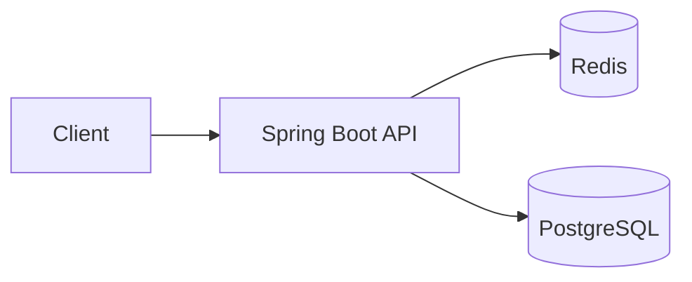
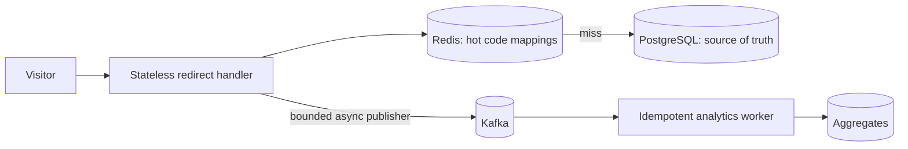

# System design

## Requirements

- Create a short code for an HTTP(S) destination, optionally accepting a custom code.
- Resolve a code to its destination and redirect quickly.
- Reject invalid schemes and duplicate custom codes.
- Preserve the mapping durably; later support expiration, disabling, and analytics.

## Workload assumptions

Redirects are expected to outnumber link creation by roughly 100:1. This is an illustrative planning assumption, not a measured production workload. It implies the redirect lookup path deserves cache and latency attention before write throughput optimization.

## Current architecture

PostgreSQL is the source of truth, providing durable mappings and a unique constraint for code allocation. Redis caches active destinations for up to five minutes, shortened to the link expiry when sooner. If Redis is unavailable, requests fall back to PostgreSQL. The current implementation uses a modular monolith to keep the first version easy to run and reason about.

## Evolution path

1. Add cache stampede protection.
2. Add a durable transactional outbox to eliminate the in-process analytics queue loss window.
3. Add link ownership/authentication, quotas, and abuse controls before exposing creation/deactivation to the public.
4. Measure p50/p95/p99 latency, throughput, and cache hit rate under representative load.

## Key trade-offs

- **Code allocation:** random Base62 codes are simple and avoid a central counter. A unique database constraint remains authoritative; collisions are retried a bounded number of times. A range-based distributed ID allocator can reduce write coordination at larger scale, but codes become more predictable.
- **Redirect status:** use 302 so clients do not permanently cache a destination that may later be disabled or changed.
- **Consistency:** mapping creation and code uniqueness are durable database operations. Click analytics can be eventually consistent; resolution must check mapping state and expiration. Redirects submit clicks to a bounded in-process queue before Kafka. Queue overload or process shutdown can lose analytics events while redirects remain successful.
- **Failure behavior:** PostgreSQL is required in this first version. After Redis is added, cache failure should fall back to the database with bounded timeouts and database protection.
