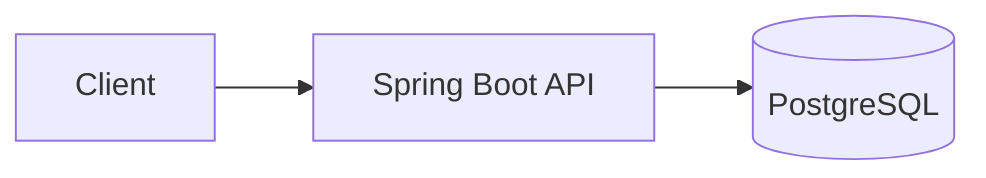
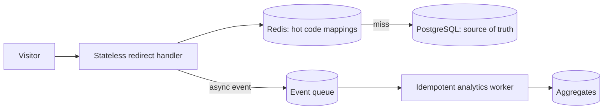

# System design

## Requirements

- Create a short code for an HTTP(S) destination, optionally accepting a custom code.
- Resolve a code to its destination and redirect quickly.
- Reject invalid schemes and duplicate custom codes.
- Preserve the mapping durably; later support expiration, disabling, and analytics.

## Workload assumptions

Redirects are expected to outnumber link creation by roughly 100:1. This is an illustrative planning assumption, not a measured production workload. It implies the redirect lookup path deserves cache and latency attention before write throughput optimization.

## Current architecture

PostgreSQL is currently the source of truth, providing durable mappings and a unique constraint for code allocation. The current implementation uses a modular monolith to keep the first version easy to run and reason about.

## Evolution path

1. Add Redis-aside caching with expiry-aware TTLs, cache hit/miss metrics, and database fallback.
2. Add an asynchronous click-event pipeline so redirect latency does not depend on analytics storage.
3. Make analytics consumers idempotent because queue delivery may retry.
4. Add load tests and report measured p50/p95/p99 latency, throughput, and cache hit rate with the test environment recorded.

## Key trade-offs

- **Code allocation:** random Base62 codes are simple and avoid a central counter. A unique database constraint remains authoritative; collisions are retried a bounded number of times. A range-based distributed ID allocator can reduce write coordination at larger scale, but codes become more predictable.
- **Redirect status:** use 302 so clients do not permanently cache a destination that may later be disabled or changed.
- **Consistency:** mapping creation and code uniqueness are durable database operations. Click analytics can be eventually consistent; resolution must check mapping state and expiration.
- **Failure behavior:** PostgreSQL is required in this first version. After Redis is added, cache failure should fall back to the database with bounded timeouts and database protection.
